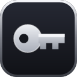

<p align="center">
  
</p>

<h1 align="center">Local Keys</h1>

<p align="center">
  A password manager for Windows, Linux and Android. Your vault is one encrypted file that you keep; no account, no cloud.<br>
  <a href="https://github.com/Anon5T4R/Local-Keys/releases/latest">Download</a> ·
  <a href="#how-your-vault-is-protected">How the vault is protected</a> ·
  <a href="#where-it-comes-from">Where it comes from</a> ·
  <a href="#how-it-is-made">How it is made</a>
</p>

<!-- README-SHOT: a demo vault (fake entries only) with the list and one login open; dark and light -->
<p align="center">
  <picture>
    <source media="(prefers-color-scheme: dark)" srcset="docs/images/readme/main-dark.png">
    
  </picture>
</p>

## How it works

Your passwords live in one `.tkeys` file, wherever you put it: a local folder, a USB stick, or a
folder that OneDrive, Syncthing or similar keeps in sync. Local Keys never talks to a server of its
own; to have the vault on two devices, you sync the file yourself and the app merges the two copies
when you ask (it shows a summary before writing anything).

## What it does

- Entries of several kinds: logins (with TOTP codes and passkeys), cards, identities, secure notes and
  free-form items, with custom fields, attachments, folders, favorites and a trash.
- TOTP from an `otpauth://` link or a QR code (from an image, the clipboard or, on Android, the camera).
- Password and passphrase generator with a strength meter.
- Import from KeePass (`.kdbx`), Bitwarden (encrypted or plain export) and CSV (Chrome/Edge and
  Google Password Manager, LastPass, 1Password, or any CSV with a column mapping). Export to JSON or CSV, **unencrypted**: the app warns you, and the file
  is then yours to protect.
- Merge with another copy of the vault (manual, with a summary first).
- Desktop: quick unlock with the OS key store on Windows, a tray icon, and copying that stays out of
  the clipboard history.
- Android: autofill in apps and browsers, the Android 14+ credential provider (passwords and passkeys),
  and fingerprint unlock.

What is planned or missing is in the [roadmap](ROADMAP.md).

## How your vault is protected

- **Key derivation:** Argon2id from your master password and a random salt (64 MiB of memory,
  3 iterations by default). The parameters are stored in the file, so stronger defaults later do not
  lock out older vaults.
- **Encryption:** XChaCha20-Poly1305 over the whole vault. The file header (format version, KDF
  parameters, salt, nonce) is authenticated as associated data, so tampering with any of it makes the
  vault refuse to open. A wrong password and a modified file give the same error on purpose.
- **No homemade cryptography.** Only audited RustCrypto crates are used, and the vault code has no
  `unsafe` blocks. The desktop app uses `unsafe` only to call the Windows API (window and tray
  control).
- **Same code on every platform.** The Android app runs the same Rust core as the desktop (through
  UniFFI), so the file format and the cryptography are one implementation, tested against shared
  test vaults.
- **Writes are careful.** The vault is written to a temporary file and then renamed, and fields the
  app does not know are kept as they are. On Android, a change made by another device is detected
  before saving instead of being overwritten silently.
- **Copying a password** marks it so Windows keeps it out of the clipboard history (Win+V) and cloud
  clipboard, and clears it after 30 seconds if it is still there.

The vault format is documented in [`crates/core/src/crypto.rs`](crates/core/src/crypto.rs), and the
merge rules in [docs/sync-merge.md](docs/sync-merge.md).

**What it does not protect against:** malware running on your computer or phone while the vault is
open, a weak master password, and the unencrypted files you export. If you forget the master
password, the vault cannot be recovered; that is the point.

## Network and privacy

- The vault's content never leaves your device through the app.
- The desktop app asks GitHub for a newer version when it starts (there is no setting to turn this
  off yet). On Android the update check is off until you turn it on.
- No account, analytics or crash reporting.

## Download

Windows 10/11 (x64): `.msi` installer or portable `.zip`. Linux (x86_64): `.AppImage`, `.tar.gz`,
`.deb`, `.rpm` or Arch package. Android: `.apk`. All in
[Releases](https://github.com/Anon5T4R/Local-Keys/releases). macOS is not published.

Each desktop file is signed with [minisign](https://jedisct1.github.io/minisign/), the same key as
every Local app; the Android `.apk` is signed with the app's release key.

```sh
minisign -Vm <file> -P RWTqN+hTTCFbDCGCA1cEJRLp2FSluxIUiJfqdoAYwkwNNVH5MTYH8qSN
```

## Where it comes from

Local Keys is our own app. It started as a Tauri (Rust and web UI) app of the same name, also ours;
this version rewrites the interface in Rust and egui and keeps the vault format byte for byte, so a
vault made by any version opens in any other. The Android app began as a separate Kotlin project and
moved into [`android/`](android/), where it now uses the shared Rust core.

## How the app is built

| Part | What it holds |
|---|---|
| `crates/core` | the vault: file format and cryptography, entries, importers, export, TOTP, generator, merge. No UI |
| `crates/ffi` | the bridge that exposes the core to Kotlin (UniFFI); built only for Android |
| `src/` | the desktop app (egui) |
| `android/` | the Android app (Kotlin and Jetpack Compose) on top of the core |
| `testdata/` | vaults and merge cases that both platforms must read and produce the same way |

## Build from source

```sh
git clone https://github.com/Anon5T4R/Local-Keys
cd Local-Keys
cargo run --release      # the desktop app
cargo xtask ci           # all local checks
```

The Android build needs the Android SDK and NDK, Rust's `*-linux-android` targets and
`cargo-ndk`; Gradle builds the Rust core by itself (`android/`).

## How it is made

Local Keys follows the same rules as every Local app: local files and no account, Rust only
(including the UI and the cryptography), one self-contained repository per app, governed
dependencies and signed releases built from a tag. Most of the code is written by AI coding agents
(Claude Code and OpenCode) from written plans, reviewed by the maintainer and held to the same checks
and CI. For a password manager we think you should know that, and judge it by what you can check:
the format, the crates it uses and the tests are all here. The reasons for each decision:
[How we make the Local apps](https://github.com/Styx-Studios/.github/blob/main/profile/README.md#how-we-make-the-local-apps).

## License

MIT or Apache-2.0, at your option ([LICENSE-MIT](LICENSE-MIT), [LICENSE-APACHE](LICENSE-APACHE)).
Other Local apps: [the full list](https://github.com/Styx-Studios).
